# Time-aware sequential recommender microbench (HSTU-inspired, CPU-only)

This is a reproducible, CPU-only test of whether the levers in Shopify's generative-recommender post hold up on public data. The levers are time-aware attention, shared and hard negatives, and incremental recall versus an ensemble.
It covers two datasets: MovieLens-1M, and Amazon Reviews 2023 Industrial & Scientific as the e-commerce set.
It compares Pop, RecentPop, ItemKNN, SASRec and HSTU, each with and without time features.
Results carry 95% CIs over users × seeds, with Holm-corrected paired tests.

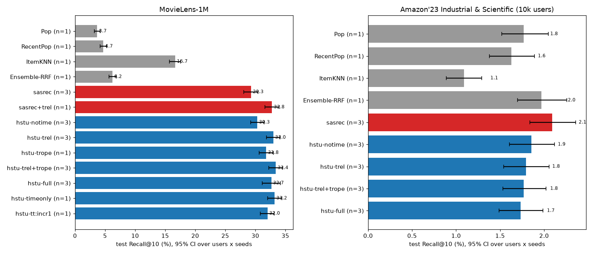
*Alt: Recall@10 overview: horizontal bars of test Recall@10 with 95% CIs for every model on both datasets. Data: [`results/ml1m/summary.json`](results/ml1m/summary.json), [`results/amz_Industrial_and_Scientific_u10k/summary.json`](results/amz_Industrial_and_Scientific_u10k/summary.json). Script: [`scripts/make_figures.py`](scripts/make_figures.py).*

## Key findings

> Final results: 3 seeds for the core configs, 1 seed for the secondary ablations and the negatives sweep. Every number below comes from the tables in this README, which [`scripts/readme_tables.py`](scripts/readme_tables.py) renders from `results/*/summary.json` (written by [`scripts/aggregate.py`](scripts/aggregate.py)), or from the query-time ablation JSON. Each finding links the figure that shows it.

0. **What "query time" means here, and why it matters.** The query time at test is the **timestamp of the held-out target event**, and every time feature is computed relative to it. The target's item is never visible, but its timestamp is.
   - On ML-1M, 74% of test targets (4,495 of 6,040 users) come less than a minute after the last history event, inside the same rating session ([`results/ml1m/recall_by_gap.json`](results/ml1m/recall_by_gap.json), bucket sizes in the recall-by-gap figure).
   - The eval-only ablation ([`scripts/eval_query_time.py`](scripts/eval_query_time.py), data in [`results/ml1m/query_time_ablation.json`](results/ml1m/query_time_ablation.json)) re-scores every trained checkpoint with the query time set to the *last history event's* timestamp, so the model can no longer tell how long ago the user acted.
   - **Final result (3 seeds, ML-1M):** hstu-trel falls from 32.99 to 30.21 Recall@10 (−2.78 pp [−3.45, −2.07]), hstu-trel+trope from 33.41 to 30.54 (−2.87 pp [−3.55, −2.18]) and hstu-full from 32.67 to 30.36 (−2.30 pp [−3.25, −1.46]). That is back to hstu-notime (30.33). sasrec+trel (1 seed) falls by 2.07 pp [−2.75, −1.37], to 30.71. Models without time features are unchanged, as they must be.
   - **So most of the ML-1M relative-time gain comes from the query timestamp revealing sub-minute gaps to the target, not from the timestamps inside the history.** The trained-in gain (hstu-trel vs hstu-notime, +2.67 pp) is about the size of the drop.
   - On Amazon the drop is at most 0.03 pp and no CI excludes zero ([`results/amz_Industrial_and_Scientific_u10k/query_time_ablation.json`](results/amz_Industrial_and_Scientific_u10k/query_time_ablation.json)). See the query-time figure below.
1. **Time in attention helps on ML-1M, by modelling rating sessions.** These comparisons are paired over users, Holm-corrected, and shown in the forest plot.
   - The relative time bias (`trel`) adds +2.67 pp Recall@10 [+1.84, +3.51] on HSTU (3 seeds) and +3.49 pp [+2.62, +4.44] on SASRec (sasrec+trel has 1 seed). Time RoPE alone adds +1.48 pp [+0.62, +2.30], and trel+trope adds +3.08 pp [+2.19, +3.96].
   - Adding calendar embeddings on top (hstu-full) does not help: −0.74 pp [−2.03, +0.41]. The bootstrap CI over users and seeds crosses zero, though the user-level sign-flip test is significant (Holm p = 0.016), so it is at best neutral.
   - The recall-by-gap figure shows the gain sits in the < 1 min bucket (hstu-trel+trope 41.1% vs hstu-notime 37.4%). That is the ML-1M rating-burst artefact, not long-horizon seasonality.
   - Best ML-1M model: hstu-trel+trope at 33.41 [32.26, 34.55] Recall@10, +4.12 pp [+3.15, +5.13] over SASRec. Without time, HSTU beats SASRec by +1.04 pp [+0.22, +1.89].
2. **On the sparse Amazon subsample, nothing beats popularity by much, and time features do not help.**
   - SASRec is best at 2.09 [1.84, 2.36] Recall@10, against Pop at 1.77 and the RRF ensemble at 1.97. HSTU is slightly below SASRec (hstu-notime −0.24 pp [−0.46, −0.01]), and trel or trel+trope change Recall@10 by less than 0.1 pp with CIs spanning zero.
   - Sequences are short (median 6) and the catalog is large (22k items) for 81k events, and the models peak within 5 to 9 epochs (training-curves figure). The Shopify regime, with billions of events, is far from this.
3. **Incremental recall.** On ML-1M the neural models reach 17 to 20% Incr@10, meaning they rank the target in their top 10 for that share of users whose target the union of Pop, RecentPop and ItemKNN misses (union Recall@10 is 20.33%). Time features raise Incr@10 with Recall@10 (hstu-trel+trope vs hstu-notime +2.46 pp [+1.82, +3.11]). Boosting-style training on ensemble misses (`hstu-tt:incr1`, 1 seed) does not raise Incr@10 (+0.18 pp [−0.45, +0.84]) and costs 1.39 pp [0.59, 2.19] of Recall@10. On Amazon, Incr@10 stays below 1%. See the incremental-recall figure.
4. **Negative sampling is a real lever (ML-1M, HSTU trel+trope, 1 seed).** See the negatives heatmap.
   - More shared negatives help a lot: Recall@10 is 24.85 at S = 128, 30.20 at S = 512 and 32.76 at S = 2048, against 33.41 for the full softmax.
   - 16 hard ItemKNN negatives add nothing at S = 512 (−0.66 pp [−1.57, +0.25]); at S = 2048 the gap to full softmax is within noise (33.10 vs 33.41).
   - Positive-aware masking matters: hard negatives without it cost 2.07 pp [1.16, 3.10] of Recall@10.
5. **Cost.** On one CPU thread, at history length 200 and batch 1, median latency is 2.0 ms for hstu-notime and 3.1 ms for hstu-trel+trope; training throughput at length 100 drops from 312 to 198 sequences/s. The overhead comes mostly from the per-pair bias gather and the rotary maths. The box was shared (load average ~30 on 8 CPUs), so the ordering is more trustworthy than the absolute numbers ([`results/bench.json`](results/bench.json), latency figure).

## Results (test, leave-one-out, full-catalog ranking; %, 95% hierarchical-bootstrap CI)

<!-- TABLES:BEGIN -->
#### MovieLens-1M (6,040 users, 3,706 items)

| model | seeds | Recall@2 | Recall@10 | NDCG@10 | Incr@10 vs ensemble |
|---|---|---|---|---|---|
| Pop | 1 | 0.91 [0.68, 1.18] | **3.69 [3.25, 4.19]** | 1.80 [1.55, 2.07] | 0.00 [0.00, 0.00] |
| RecentPop | 1 | 1.18 [0.91, 1.46] | **4.72 [4.21, 5.26]** | 2.33 [2.04, 2.63] | 0.00 [0.00, 0.00] |
| ItemKNN | 1 | 5.84 [5.26, 6.46] | **16.66 [15.73, 17.57]** | 9.14 [8.59, 9.70] | 0.00 [0.00, 0.00] |
| Ensemble-RRF | 1 | 1.79 [1.47, 2.14] | **6.23 [5.65, 6.85]** | 3.20 [2.86, 3.57] | 0.56 [0.38, 0.78] |
| sasrec | 3 | 11.62 [10.87, 12.38] | **29.29 [28.07, 30.47]** | 16.81 [16.13, 17.50] | 16.96 [16.02, 17.93] |
| sasrec+trel | 1 | 14.29 [13.41, 15.17] | **32.78 [31.62, 33.97]** | 19.51 [18.72, 20.34] | 19.74 [18.74, 20.75] |
| hstu-notime | 3 | 12.22 [11.48, 12.99] | **30.33 [29.23, 31.45]** | 17.45 [16.74, 18.20] | 17.69 [16.78, 18.63] |
| hstu-trel | 3 | 14.65 [13.66, 15.66] | **32.99 [31.87, 34.10]** | 19.82 [19.01, 20.65] | 20.05 [19.05, 21.05] |
| hstu-trope | 1 | 13.41 [12.55, 14.25] | **31.80 [30.65, 33.00]** | 18.54 [17.80, 19.29] | 18.99 [18.00, 20.03] |
| hstu-trel+trope | 3 | 14.63 [13.76, 15.52] | **33.41 [32.26, 34.55]** | 19.91 [19.04, 20.73] | 20.15 [19.21, 21.11] |
| hstu-full | 3 | 14.45 [13.68, 15.28] | **32.67 [31.18, 34.13]** | 19.47 [18.54, 20.32] | 19.69 [18.38, 20.93] |
| hstu-timeonly | 1 | 14.22 [13.33, 15.05] | **33.20 [32.07, 34.39]** | 19.61 [18.82, 20.41] | 19.98 [18.97, 20.99] |
| hstu-tt:incr1 | 1 | 13.64 [12.81, 14.52] | **32.02 [30.84, 33.16]** | 18.75 [17.98, 19.56] | 20.33 [19.30, 21.36] |

Planned comparisons (Recall@10, percentage points; Holm over the family; full table incl. NDCG@10 and Incr@10 in [`results/ml1m/summary.md`](results/ml1m/summary.md)):

| A vs B | diff [95% CI] | p sign-flip | p Holm |
|---|---|---|---|
| hstu-trel vs hstu-notime | +2.67 [+1.84, +3.51] | 0.0001 | 0.0012 |
| hstu-trope vs hstu-notime | +1.48 [+0.62, +2.30] | 0.0003 | 0.0015 |
| hstu-trel+trope vs hstu-notime | +3.08 [+2.19, +3.96] | 0.0001 | 0.0012 |
| hstu-full vs hstu-trel+trope | -0.74 [-2.03, +0.41] | 0.0052 | 0.0156 |
| hstu-timeonly vs hstu-trel+trope | -0.21 [-0.99, +0.56] | 0.5374 | 0.5374 |
| sasrec+trel vs sasrec | +3.49 [+2.62, +4.44] | 0.0001 | 0.0012 |
| hstu-notime vs sasrec | +1.04 [+0.22, +1.89] | 0.0004 | 0.0016 |
| hstu-trel+trope vs sasrec | +4.12 [+3.15, +5.13] | 0.0001 | 0.0012 |
| hstu-tt:incr1 vs hstu-trel+trope | -1.39 [-2.19, -0.59] | 0.0002 | 0.0012 |
| neg:S512-H16 vs neg:S512-H0 | -0.66 [-1.57, +0.25] | 0.1669 | 0.3338 |
| neg:S512-H16-nopa vs neg:S512-H16 | -2.07 [-3.10, -1.16] | 0.0001 | 0.0012 |
| neg:S512-H16 vs hstu-trel+trope | -3.87 [-4.75, -2.96] | 0.0001 | 0.0012 |

#### Amazon'23 Industrial & Scientific, 10k-user subsample (21,949 items)

| model | seeds | Recall@2 | Recall@10 | NDCG@10 | Incr@10 vs ensemble |
|---|---|---|---|---|---|
| Pop | 1 | 0.49 [0.36, 0.63] | **1.77 [1.52, 2.05]** | 0.88 [0.73, 1.03] | 0.00 [0.00, 0.00] |
| RecentPop | 1 | 0.51 [0.37, 0.65] | **1.63 [1.38, 1.89]** | 0.84 [0.70, 0.99] | 0.00 [0.00, 0.00] |
| ItemKNN | 1 | 0.43 [0.30, 0.55] | **1.09 [0.89, 1.29]** | 0.63 [0.50, 0.75] | 0.00 [0.00, 0.00] |
| Ensemble-RRF | 1 | 0.59 [0.44, 0.75] | **1.97 [1.70, 2.26]** | 1.03 [0.88, 1.20] | 0.16 [0.09, 0.24] |
| sasrec | 3 | 0.87 [0.69, 1.05] | **2.09 [1.84, 2.36]** | 1.22 [1.05, 1.40] | 0.92 [0.75, 1.09] |
| hstu-notime | 3 | 0.80 [0.64, 0.97] | **1.86 [1.61, 2.12]** | 1.11 [0.94, 1.28] | 0.82 [0.65, 0.99] |
| hstu-trel | 3 | 0.86 [0.69, 1.04] | **1.79 [1.54, 2.06]** | 1.11 [0.94, 1.28] | 0.79 [0.60, 0.99] |
| hstu-trel+trope | 3 | 0.79 [0.62, 0.97] | **1.77 [1.53, 2.02]** | 1.09 [0.92, 1.26] | 0.77 [0.62, 0.94] |
| hstu-full | 3 | 0.79 [0.64, 0.96] | **1.73 [1.49, 1.99]** | 1.05 [0.90, 1.22] | 0.74 [0.60, 0.89] |

Planned comparisons (Recall@10, percentage points; Holm over the family; full table incl. NDCG@10 and Incr@10 in [`results/amz_Industrial_and_Scientific_u10k/summary.md`](results/amz_Industrial_and_Scientific_u10k/summary.md)):

| A vs B | diff [95% CI] | p sign-flip | p Holm |
|---|---|---|---|
| hstu-trel vs hstu-notime | -0.06 [-0.26, +0.14] | 0.2004 | 0.6011 |
| hstu-trel+trope vs hstu-notime | -0.09 [-0.28, +0.12] | 0.2374 | 0.6011 |
| hstu-full vs hstu-trel+trope | -0.04 [-0.25, +0.16] | 0.6553 | 0.6553 |
| hstu-notime vs sasrec | -0.24 [-0.46, -0.01] | 0.0062 | 0.0248 |
| hstu-trel+trope vs sasrec | -0.32 [-0.54, -0.10] | 0.0005 | 0.0025 |

<!-- TABLES:END -->

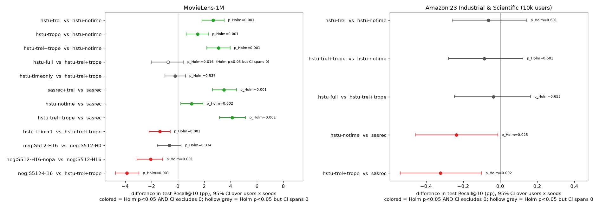
*Alt: forest plot of the planned paired comparisons (difference in Recall@10, pp, 95% CI); green or red = Holm p<0.05. Data: [`results/ml1m/summary.json`](results/ml1m/summary.json), [`results/amz_Industrial_and_Scientific_u10k/summary.json`](results/amz_Industrial_and_Scientific_u10k/summary.json). Script: [`scripts/make_figures.py`](scripts/make_figures.py).*

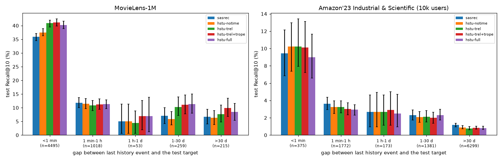
*Alt: test Recall@10 per model, split by the gap between the last history event and the test target (<1 min ... >30 d), with bootstrap CIs and bucket sizes. Data: [`results/ml1m/recall_by_gap.json`](results/ml1m/recall_by_gap.json), [`results/amz_Industrial_and_Scientific_u10k/recall_by_gap.json`](results/amz_Industrial_and_Scientific_u10k/recall_by_gap.json). Script: [`scripts/make_figures.py`](scripts/make_figures.py).*

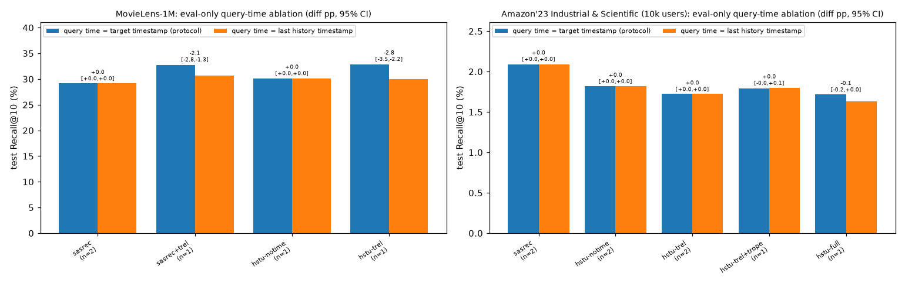
*Alt: paired bars of test Recall@10 for each trained checkpoint evaluated with the protocol query time (target timestamp) and with the last history timestamp, with the difference and its 95% CI. Data: [`results/ml1m/query_time_ablation.json`](results/ml1m/query_time_ablation.json), [`results/amz_Industrial_and_Scientific_u10k/query_time_ablation.json`](results/amz_Industrial_and_Scientific_u10k/query_time_ablation.json). Script: [`scripts/eval_query_time.py`](scripts/eval_query_time.py), [`scripts/make_figures.py`](scripts/make_figures.py).*

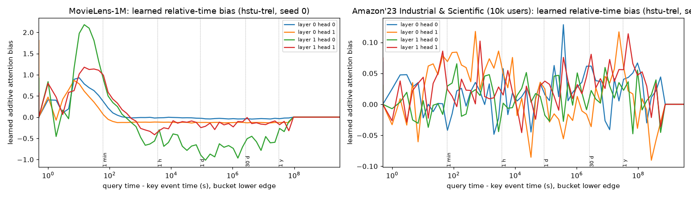
*Alt: learned additive attention bias per log-time bucket (per layer and head) of hstu-trel seed 0; the bias is large for gaps of about 10 s to 1 min (rating sessions) on ML-1M. Data: [`results/ml1m/learned_time_bias.json`](results/ml1m/learned_time_bias.json), [`results/amz_Industrial_and_Scientific_u10k/learned_time_bias.json`](results/amz_Industrial_and_Scientific_u10k/learned_time_bias.json). Script: [`scripts/make_figures.py`](scripts/make_figures.py).*

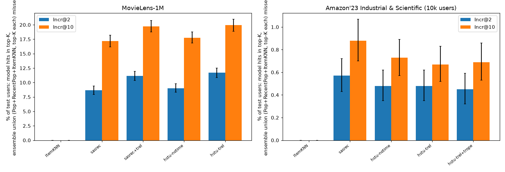
*Alt: Incr@2 and Incr@10 per model: share of test users whose target the model ranks in its top-K while the union of Pop, RecentPop and ItemKNN top-K misses it. Data: [`results/ml1m/summary.json`](results/ml1m/summary.json), [`results/amz_Industrial_and_Scientific_u10k/summary.json`](results/amz_Industrial_and_Scientific_u10k/summary.json). Script: [`scripts/make_figures.py`](scripts/make_figures.py).*

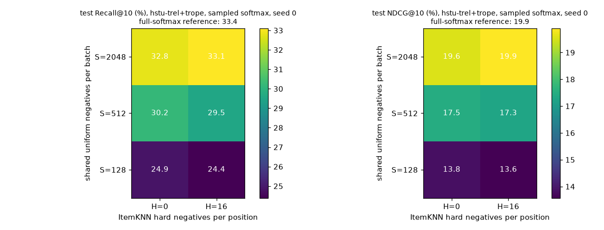
*Alt: heatmap of test Recall@10 and NDCG@10 for sampled-softmax training of hstu-trel+trope over shared negatives S x hard negatives H (seed 0), with the full-softmax reference in the title. Data: [`results/ml1m/summary.json`](results/ml1m/summary.json) (configs neg:*). Script: [`scripts/make_figures.py`](scripts/make_figures.py).*

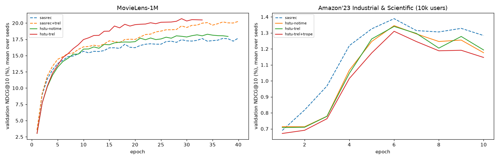
*Alt: validation NDCG@10 per epoch (mean over seeds) for the main configs; the timeline of training until early stopping. Data: [`results/ml1m/summary.json`](results/ml1m/summary.json), [`results/amz_Industrial_and_Scientific_u10k/summary.json`](results/amz_Industrial_and_Scientific_u10k/summary.json). Script: [`scripts/make_figures.py`](scripts/make_figures.py).*

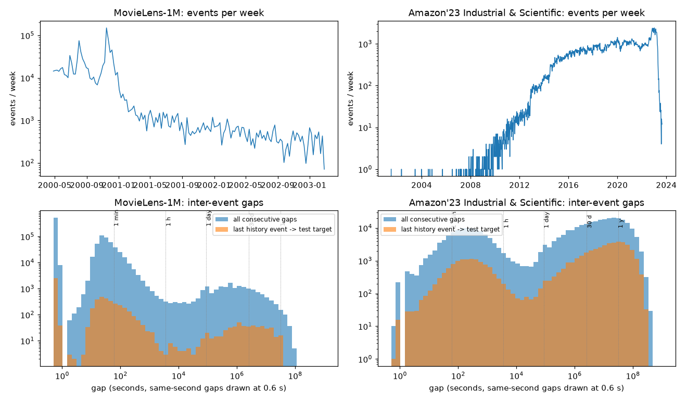
*Alt: events per week over time and inter-event gap histograms for both datasets, showing ML-1M's minute-scale rating bursts and Amazon's day-to-year gaps. Data: [`results/data_stats.json`](results/data_stats.json); script [`scripts/plot_data.py`](scripts/plot_data.py). Script: [`scripts/make_figures.py`](scripts/make_figures.py).*

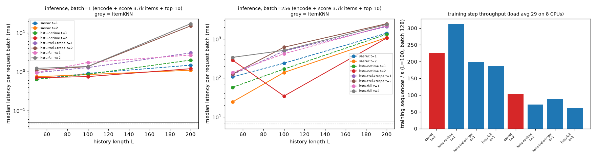
*Alt: CPU inference latency vs history length for batch 1 and 256 (1 and 2 threads; grey = ItemKNN), and training-step throughput, on a shared box at load average ~30 on 8 CPUs. Data: [`results/bench.json`](results/bench.json); script [`scripts/bench.py`](scripts/bench.py). Script: [`scripts/make_figures.py`](scripts/make_figures.py).*

## What this is

This is a CPU-only microbenchmark of the ideas in Shopify Engineering's post
[*The generative recommender behind Shopify's commerce engine*](https://shopify.engineering/generative-recommendations)
(Yang Liu and Ali Khanafer, Feb 25 2026). It runs on public data. It does **not** reproduce Shopify's
proprietary stack. Instead it isolates the levers the post describes and tests each one with seeds, confidence intervals and ablations:

| Shopify lever (post) | What is implemented here | Where |
|---|---|---|
| HSTU-style generative sequential model ([Zhai et al. 2024, arXiv:2402.17152](https://arxiv.org/abs/2402.17152)) | 2-layer HSTU block: pointwise SiLU attention, U-gating, relative attention bias. Compared against a SASRec-style softmax Transformer | [`tasr/models.py`](tasr/models.py) |
| "time as a first-class signal inside attention": relative attention bias for time gaps and recency | `trel`: learned per-head bias over log-bucketed `query_time - key_time` | `Block.bias` |
| "RoPE-inspired rotary encoding so attention can carry an absolute notion of time" | `trope`: rotary encoding driven by timestamps in seconds; q at the query time, k at the event time | `TimeRoPE` |
| "incorporate the current session timestamp at inference" | every query position carries the timestamp of the event being predicted. At test time that is the request time, so it is known before the item is | `SeqData.eval_batch` |
| absolute / seasonal context | `tabs`: hour-of-day, day-of-week and month-of-year embeddings of events and of the query time | `SeqRec._cal` |
| shared negatives + positive-aware hard negatives in sampled softmax | `S` uniform negatives shared by the whole batch, plus `H` per-position hard negatives from ItemKNN neighbours. Optionally masked against the user's known positives | [`tasr/train.py`](tasr/train.py) |
| "incremental recall": find positives the ensemble misses; boosting-style training | Incr@K metric vs. the union of Pop, RecentPop and ItemKNN; `--incr-beta` upweights training targets the ensemble misses | [`tasr/ensemble.py`](tasr/ensemble.py), [`scripts/incremental_flags.py`](scripts/incremental_flags.py) |
| serving and training efficiency | CPU latency and throughput microbenchmarks | [`scripts/bench.py`](scripts/bench.py) |

## Architecture

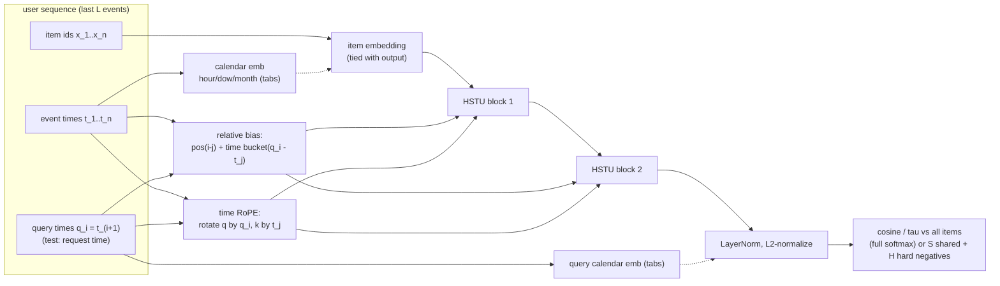

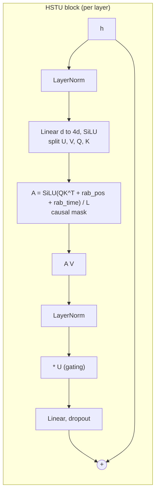

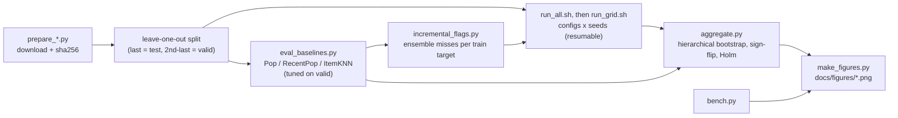

## Install and reproduce (fresh clone)

Tested with Python 3.13.5 on linux x86_64, CPU only. [`requirements.txt`](requirements.txt) pins the direct dependencies, and [`requirements-lock.txt`](requirements-lock.txt) is the full `pip freeze` of the venv that produced every reported number.

```bash
git clone https://github.com/arman-dogru/time-aware-sequential-recommender && cd time-aware-sequential-recommender
python3 -m venv .venv
.venv/bin/pip install -r requirements-lock.txt        # or: -r requirements.txt (direct pins), -r requirements-dev.txt (+pytest)
.venv/bin/python -m pytest -q tests                    # unit + mutation tests (seconds)
export PYTHONPATH=.                                    # scripts default to PY=.venv/bin/python (override with PY=...)

# 1. data (downloads are sha256-checked; raw data is never committed)
.venv/bin/python scripts/prepare_ml1m.py
.venv/bin/python scripts/prepare_amazon.py --max-users 10000
.venv/bin/python scripts/plot_data.py                  # docs/figures/data_timeline.png

# 2. baselines and ensemble (tuned on validation) + incremental-training flags
.venv/bin/python scripts/eval_baselines.py
.venv/bin/python scripts/eval_baselines.py --data data/processed/amz_Industrial_and_Scientific_u10k.npz --max-len 50
.venv/bin/python scripts/incremental_flags.py

# 3. the grid (tasr/configs.py SCHEDULE; resumable, lock-aware; logs/grid.log). Hours of CPU time.
ML_JOBS=4 AMZ_JOBS=2 nohup scripts/run_all.sh &

# 4. once the grid is done: completeness check, tests, bench, aggregation, query-time ablation,
#    figures, README tables, then commit and push (fast-forward only, never force)
scripts/finalize.sh            # or step by step:
.venv/bin/python scripts/check_grid.py
.venv/bin/python scripts/aggregate.py --ds ml1m && .venv/bin/python scripts/aggregate.py --ds amz_Industrial_and_Scientific_u10k
.venv/bin/python scripts/eval_query_time.py && .venv/bin/python scripts/bench.py
.venv/bin/python scripts/make_figures.py && .venv/bin/python scripts/readme_tables.py
```

A single run: `.venv/bin/python -m tasr.train --name hstu-trel --loss full --arch hstu --pos rel --trel 1 --seed 0` (writes `runs/ml1m/hstu-trel/seed0/`).

## Caveats

- **ML-1M timestamps are rating times, not consumption times.** 88.5% of consecutive gaps are under a minute. The time features mostly learn session structure, so the gain does not show that seasonality modelling works.
- **Amazon is a 10k-user subsample** (CPU budget), and a review stands in for a purchase. All models stay close to popularity there. Full-catalog baselines on the 51k-user set are in [`results/amz_Industrial_and_Scientific/`](results/amz_Industrial_and_Scientific/baselines.json).
- **Seeds.** There are 3 seeds for the core configs, 1 for the secondary ablations and 1 for the negatives heatmap. Single-seed rows have CIs over users only.
- **Loss.** The architecture × time grid uses full softmax, because SASRec barely trains under uniform sampled softmax in this setup ([`docs/pilots.md`](docs/pilots.md)). Shopify's sampled-softmax regime is studied only on HSTU.
- **Max epochs.** Some SASRec runs reached the 40-epoch cap while still improving slightly (`best epochs` column in `results/*/summary.md`), so SASRec may be slightly under-trained compared with HSTU.
- **Latency was measured on a shared box** at load average ~30 on 8 cores. Absolute numbers are pessimistic; the relative ordering is the useful part. The encoder computes all L positions; a serving path would cache keys and values.
- This is a microbench of public ideas, not a reproduction of Shopify's system or numbers.

## References

- Yang Liu, Ali Khanafer. *The generative recommender behind Shopify's commerce engine.* Shopify Engineering, Feb 25 2026. https://shopify.engineering/generative-recommendations
- Zhai et al. *Actions Speak Louder than Words: Trillion-Parameter Sequential Transducers for Generative Recommendations* (HSTU). ICML 2024. https://arxiv.org/abs/2402.17152
- Kang & McAuley. *Self-Attentive Sequential Recommendation* (SASRec). ICDM 2018.
- Harper & Konstan. *The MovieLens Datasets: History and Context.* ACM TiiS 2015.
- Hou et al. *Bridging Language and Items for Retrieval and Recommendation* (Amazon Reviews 2023). arXiv:2403.03952.
