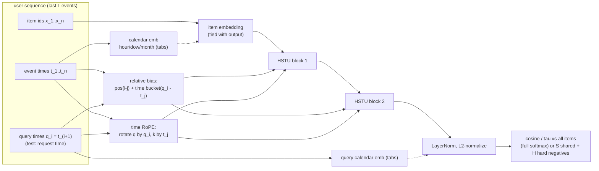
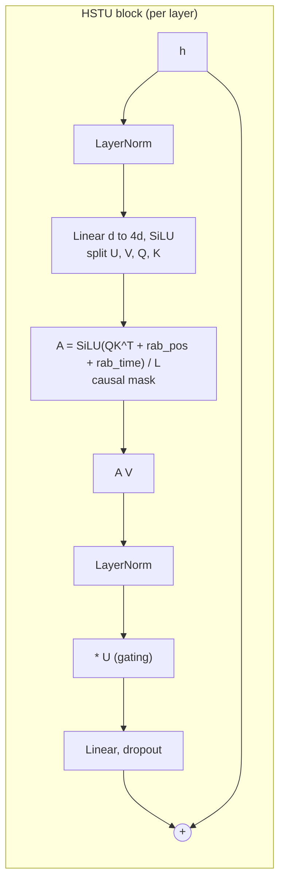
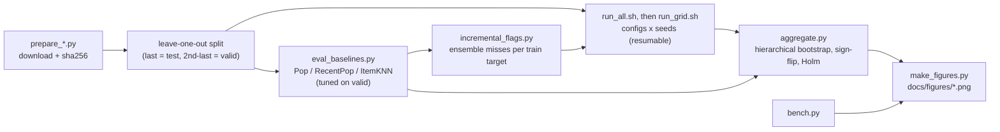

# Time-aware sequential recommender microbench (HSTU-inspired, CPU-only)

> **Status: results pending.** The experiment grid is running; the tables and figures below are filled in from `results/*/summary.md` when it finishes.


*Alt: horizontal bars of test Recall@10 with 95% CIs for every model on MovieLens-1M and Amazon'23 Industrial & Scientific. Data: [`results/ml1m/summary.json`](results/ml1m/summary.json), [`results/amz_Industrial_and_Scientific_u10k/summary.json`](results/amz_Industrial_and_Scientific_u10k/summary.json). Script: [`scripts/make_figures.py`](scripts/make_figures.py).*

## What this is

This is a CPU-only microbenchmark of the ideas in Shopify Engineering's post
[*The generative recommender behind Shopify's commerce engine*](https://shopify.engineering/generative-recommendations)
(Yang Liu and Ali Khanafer, Feb 25 2026). It runs on public data. It does **not** reproduce Shopify's
proprietary stack. Instead it isolates the levers the post describes and tests each one with seeds, confidence intervals and ablations:

| Shopify lever (post) | What is implemented here | Where |
|---|---|---|
| HSTU-style generative sequential model ([Zhai et al. 2024, arXiv:2402.17152](https://arxiv.org/abs/2402.17152)) | 2-layer HSTU block: pointwise SiLU attention, U-gating, relative attention bias. Compared against a SASRec-style softmax Transformer | [`tasr/models.py`](tasr/models.py) |
| "time as a first-class signal inside attention": relative attention bias for time gaps and recency | `trel`: learned per-head bias over log-bucketed `query_time - key_time` | `Block.bias` |
| "RoPE-inspired rotary encoding so attention can carry an absolute notion of time" | `trope`: rotary encoding driven by timestamps in seconds; q at the query time, k at the event time | `TimeRoPE` |
| "incorporate the current session timestamp at inference" | every query position carries the timestamp of the event being predicted. At test time that is the request time, so it is known before the item is | `SeqData.eval_batch` |
| absolute / seasonal context | `tabs`: hour-of-day, day-of-week and month-of-year embeddings of events and of the query time | `SeqRec._cal` |
| shared negatives + positive-aware hard negatives in sampled softmax | `S` uniform negatives shared by the whole batch, plus `H` per-position hard negatives from ItemKNN neighbours. Optionally masked against the user's known positives | [`tasr/train.py`](tasr/train.py) |
| "incremental recall": find positives the ensemble misses; boosting-style training | Incr@K metric vs. the union of Pop, RecentPop and ItemKNN; `--incr-beta` upweights training targets the ensemble misses | [`tasr/ensemble.py`](tasr/ensemble.py), [`scripts/incremental_flags.py`](scripts/incremental_flags.py) |
| serving and training efficiency | CPU latency and throughput microbenchmarks | [`scripts/bench.py`](scripts/bench.py) |

## Architecture







## Reproduce

```bash
python -m venv .venv && .venv/bin/pip install --index-url https://download.pytorch.org/whl/cpu torch && .venv/bin/pip install numpy scipy matplotlib
export PY=.venv/bin/python PYTHONPATH=.
$PY scripts/prepare_ml1m.py                                   # GroupLens ML-1M, sha256-pinned
$PY scripts/prepare_amazon.py --max-users 10000               # Amazon Reviews 2023, 5-core, 10k-user subsample
$PY scripts/eval_baselines.py                                  # Pop / RecentPop / ItemKNN (tuned on validation)
$PY scripts/eval_baselines.py --data data/processed/amz_Industrial_and_Scientific_u10k.npz --max-len 50
$PY scripts/incremental_flags.py                               # ensemble misses per training target (for --incr-beta)
nohup scripts/run_all.sh &                                     # all configs x seeds, resumable
$PY scripts/aggregate.py --ds ml1m && $PY scripts/aggregate.py --ds amz_Industrial_and_Scientific_u10k
$PY scripts/bench.py && $PY scripts/plot_data.py && $PY scripts/make_figures.py
```
